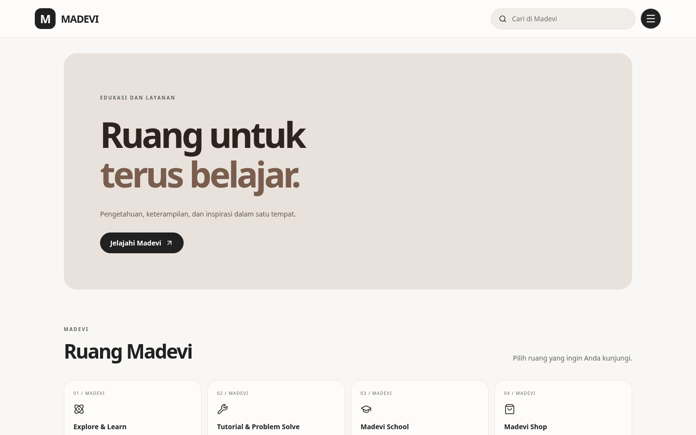
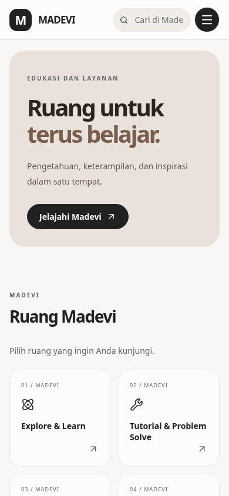
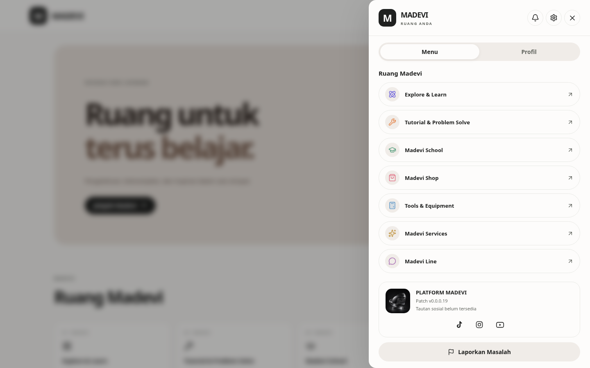
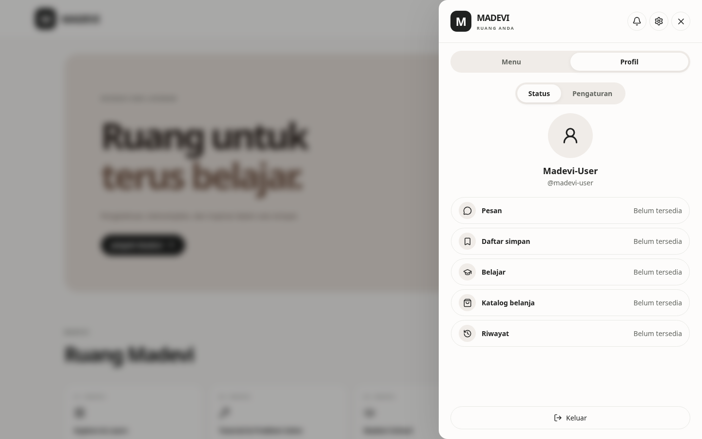
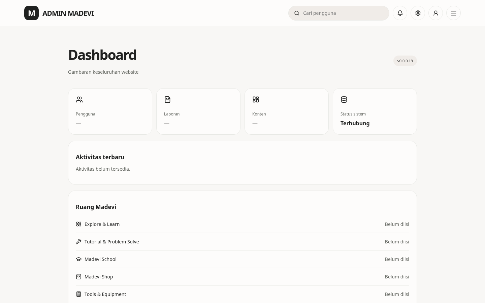

# Madevi

Madevi adalah platform web edukasi dan layanan digital. Pengunjung dapat menemukan materi pengetahuan dan panduan praktik melalui satu situs. Semua ruang memakai fondasi navigasi, akun, pencarian, dan pengelolaan konten yang sama.

| Ruang | Tujuan |
| --- | --- |
| Explore & Learn | Artikel pengetahuan mendalam dengan contoh, ilustrasi, materi teks dan video, serta rujukan. |
| Tutorial & Problem Solve | Panduan praktik bertahap dan solusi untuk masalah sehari-hari. |
| Madevi School | Jalur pendidikan terstruktur, materi, tugas, ujian, dan evaluasi. |
| Madevi Shop | Katalog afiliasi yang mengarahkan pembelian ke toko mitra. |
| Tools & Equipment | Kalkulator, konverter, simulator, dan alat bantu interaktif. |
| Madevi Services | Informasi, simulasi, dan pemesanan jasa digital. |
| Madevi Line | Ruang kreativitas dan berbagi cerita dengan fitur komunitas dan moderasi. |

Kepemilikan proyek saat ini berada pada satu pemilik dengan satu admin pengendali. Akun pengguna mengikuti pendaftaran website. Panduan [aktivasi default](docs/aktivasi-default.md) adalah titik mulai saat ingin menyiapkan layanan.

Explore & Learn dan Tutorial & Problem Solve menjadi prioritas pengembangan konten. Saat ini ketujuh halaman ruang tersedia sebagai kerangka dan taksonomi serta konten asli belum diisi. Alur bersama mencakup pencarian judul, halaman baca teks terbit, pengelolaan draf dan publikasi, profil dan avatar, notifikasi umum dan sistem, pelaporan, serta panel admin dengan MFA.

Pendaftaran, verifikasi, perubahan email, dan pemulihan kata sandi memerlukan SMTP. Google OAuth memiliki konfigurasi opsional dan masih memerlukan uji penyedia. Halaman kebijakan, bantuan, fitur simpan, dan ikon sosial developer masih berupa penanda. Modul khusus lima ruang lainnya masih direncanakan. Status proyek adalah **pengembangan lokal, belum siap menerima pengguna nyata**.

## Cuplikan aplikasi lokal

Cuplikan diambil dari build pengembangan lokal Madevi V0.0.0.19. Profil dan admin memakai akun demo sintetis. [Cara mengambil ulang galeri](docs/screenshot.md)

<table>
  <tr>
    <td></td>
    <td></td>
  </tr>
  <tr>
    <td>Beranda desktop</td>
    <td>Beranda ponsel</td>
  </tr>
</table>

<table>
  <tr>
    <td></td>
    <td></td>
    <td></td>
  </tr>
  <tr>
    <td>Sidebar</td>
    <td>Profil pengguna</td>
    <td>Dashboard admin</td>
  </tr>
</table>

## Stack dan struktur

Aplikasi memakai Node.js 24, Next.js App Router, React, TypeScript, PostgreSQL melalui `pg`, dan Better Auth. Tailwind CSS/PostCSS dan token CSS mengatur tampilan. Zod memvalidasi input, Sharp memproses gambar, dan Nodemailer mengirim email.

| Lokasi | Isi |
| --- | --- |
| [src/app](src/app), [src/proxy.ts](src/proxy.ts) | Halaman publik/admin, Route Handlers dan pengaman request. |
| [src/components](src/components), [src/lib](src/lib) | Komponen React, autentikasi, izin, data, validasi dan logika bersama. |
| [public](public) | Gambar dan font publik, termasuk [lisensi font Noto Sans](public/fonts/OFL-Noto-Sans.txt). |
| [scripts](scripts), [database](database) | Migrasi SQL, bootstrap akun, backup, dan rujukan database. |
| [tests](tests), [CI](.github/workflows/ci.yml) | Tes unit, integrasi lokal melalui skrip, dan konfigurasi GitHub Actions. |
| [docs](docs), [ops](ops) | Panduan proyek dan prosedur operasional. |

## Jalankan secara lokal

1. Siapkan Node.js 24, npm, dan database PostgreSQL terpisah untuk development. Jalankan `npm ci` dari root repo.
2. Jika `.env.local` belum ada, jalankan `cp .env.example .env.local`. Isi `DATABASE_URL` dari PostgreSQL lokal, `BETTER_AUTH_URL=http://127.0.0.1:3000` dan `BETTER_AUTH_SECRET` dengan nilai acak minimal 32 karakter. Jaga `.env.local` tetap privat.
3. Jalankan `npm run db:migrate` lalu `npm run dev`. Buka `http://127.0.0.1:3000`.
4. Untuk menguji login tanpa SMTP, gunakan [akun demo lokal terisolasi](ops/demo-terbatas.md). Untuk admin non-demo, ikuti [langkah bootstrap dan MFA](docs/online.md#5-buat-admin-dan-uji-alur).

| Perintah | Kegunaan |
| --- | --- |
| `npm run check:ready` | Validasi konfigurasi, koneksi PostgreSQL/skema dan SMTP bila diisi. |
| `npm run typecheck` dan `npm test` | Hasilkan tipe route Next.js, periksa TypeScript, dan jalankan tes unit. |
| `npm run test:integration` | Uji aplikasi lokal dengan PGlite dan SMTP palsu. Sisakan port loopback 3000, 25433, dan 25434. |
| `MADEVI_TEST_BUILD=1 npm run test:integration` | Jalankan build dalam konfigurasi uji staging, lalu uji aplikasi. |
| `npm run build` dan `npm start` | Build dan start Node.js dengan konfigurasi staging/produksi yang valid. |

Untuk langkah lengkap dan solusi masalah setup, lihat [panduan lokal](docs/lokal.md). Mulai dari [indeks dokumentasi](docs/README.md), lalu baca [fondasi proyek](docs/fundamental.md), [persiapan online](docs/online.md) atau [laporan verifikasi penataan](docs/laporan-penataan.md).

## Madevi V0.0.0.19 — Update terbaru

Pembaruan ini menyiapkan jalur aktivasi default, mengikat akses admin ke MFA per sesi, memperbaiki pembatasan request dan foto pendaftaran, serta memperluas pengujian. [Bukti verifikasi](docs/laporan-kesiapan.md)

Pembaruan utama (major) berikut dipilih berdasarkan dampaknya pada fondasi dan alur pengguna. Kategori ini untuk penyajian riwayat. Nomor versi Madevi tetap memakai empat bagian dan angka terakhir bertambah satu tiap rilis.

- **V0.0.0.19** — Kesiapan aktivasi, MFA per sesi, dan pemisahan kuota.
- **V0.0.0.18** — Penataan fondasi, galeri aplikasi, dan panduan operasional.
- **V0.0.0.17** — Penguatan alur profil dan bukti pengujian lokal.
- **V0.0.0.13** — Tata letak Default untuk beranda, sidebar, profil, dan dashboard admin.
- **V0.0.0.8** — Profil, pelaporan, dan kerangka notifikasi berbasis PostgreSQL.
- **V0.0.0.3** — Pemisahan aplikasi dari Pondasi serta konfigurasi awal server.
- **V0.0.0.2** — Fondasi konten dengan revisi, alur penerbitan, dan kontrol izin.
- **V0.0.0.1** — Kerangka awal tujuh ruang, akun, dan admin.

[Rincian perubahan dan riwayat lengkap yang tercatat](CHANGELOG.md)
