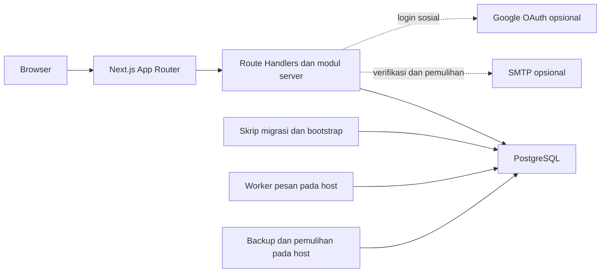

# Fundamental proyek

## Identitas dan pengguna

Pemilik mengendalikan proyek dan layanan. Satu admin utama mengendalikan fungsi pengelolaan di aplikasi. Akun website tetap mengikuti pendaftaran umum saat layanan email siap.

Madevi menggabungkan pengetahuan, panduan praktik dan layanan digital agar pengunjung dapat belajar dan mencari bantuan melalui satu situs. Prioritas berikutnya adalah Explore & Learn dan Tutorial & Problem Solve. Halaman dan navigasi ketujuh ruang sudah tersedia. Konten asli masih menunggu penyusunan. Nama serta slug ruang berasal dari [src/lib/rooms.ts](../src/lib/rooms.ts).

| Ruang / slug | Tujuan dan batas pengembangan |
| --- | --- |
| Explore & Learn / `explore` | Artikel mendalam dengan contoh, ilustrasi, materi teks/video, dan rujukan. Kerangka penerbitan teks tersedia. Taksonomi dan penyajian video perlu dirancang. |
| Tutorial & Problem Solve / `tutorial` | Panduan bertahap untuk keterampilan dan masalah nyata. Kerangka penerbitan teks tersedia. Format langkah, pemeriksaan sumber, serta kategori akan ditetapkan saat konten disiapkan. |
| Madevi School / `school` | Pendidikan terstruktur bagi anak dan pembelajar di berbagai jenjang, dengan materi, tugas, ujian, penilaian dan kelulusan. Kurikulum, perlindungan anak, kemitraan, dan pengakuan resmi masih terbuka. |
| Madevi Shop / `shop` | Katalog afiliasi untuk menemukan produk dan membeli di toko luar. Sumber harga, deskripsi dan foto bergantung pada izin/lisensi dan ketentuan mitra. Belum ada katalog atau checkout. |
| Tools & Equipment / `tools` | Kalkulator, konverter, simulator dan utilitas. Klaster, rumus, batas input dan verifikasi hasil ditentukan per alat. |
| Madevi Services / `services` | Jasa seperti desain, digital printing, undangan online dan konsultasi. Pemesanan, simulasi, status dan transaksi belum dibangun. |
| Madevi Line / `line` | Komunitas untuk kreativitas dan curhat, dengan rencana profil, pertemanan, chat, blokir, status dan unggahan karya. Saat ini hanya ada fondasi pengaturan privasi dan kelompok notifikasi sosial. Relasi, pesan dan moderasi komunitas menunggu desain keselamatan, privasi, dan retensi. |

| Pengguna | Akses saat ini |
| --- | --- |
| Pengunjung | Beranda, navigasi, halaman info, konten terbit, pencarian dan notifikasi umum. |
| Akun biasa | Satu akun lintas ruang. Profil, foto sendiri, pengaturan privasi, notifikasi yang ditujukan kepadanya, dan laporan masalah. Akun diblokir kehilangan akses yang mensyaratkan sesi. |
| Admin | Pemilik awal dibuat dengan skrip. Dapat mengelola pengguna, laporan, notifikasi dan konten. MFA pada sesi yang digunakan wajib untuk akses admin non-demo. |
| `author`, `reviewer`, `moderator` | Matriks izin membatasi penulisan, tinjauan/penerbitan, dan moderasi. Pengelolaan staf tambahan belum dioperasikan. |

Matriks izin dan pemeriksaan sesi/peran/MFA dijalankan di server. Demo adalah pengecualian khusus development lokal untuk akun sintetis. [Izin](../src/lib/permissions.ts), [akses](../src/lib/access.ts), [demo](../ops/demo-terbatas.md)

## Alur utama dan antarmuka

- Pengunjung membuka ruang lewat beranda atau sidebar, mencari judul, lalu membaca versi terbit. Halaman ruang dan tampilan pencarian adalah dua jalur berbeda. Isi ruang menunggu taksonomi dan konten. [Halaman publik](../src/app), [shell publik](../src/components/public-shell.tsx)
- Untuk akun biasa, pendaftaran mengarah ke verifikasi email. Pengguna kemudian masuk, mengelola profil dan avatar, serta membaca notifikasi. Jika Google dipasang, akun yang belum lengkap diminta menambahkan username dan tanggal lahir. Username tetap, nomor telepon dapat disimpan, dan login telepon belum tersedia. [Profil](../src/components/profile.tsx), [auth](../src/lib/auth-options.ts)
- Admin masuk melalui `/admin` dan mengaktifkan autentikator saat bootstrap. Setelah itu panel dapat menyaring hasil dengan paginasi, memblokir dan memulihkan akun, memeriksa laporan, mengirim notifikasi, atau meneruskan konten dari draf ke tinjauan dan terbit. [Panel admin](../src/components/admin-shell.tsx), [akses admin](../src/app/admin)
- Desain menggunakan sidebar kanan, header pencarian, token CSS dan mode terang/gelap. Antarmuka publik punya sebagian teks Indonesia/Inggris. Panel admin menambahkan sidebar desktop dan laci menu pada ponsel. UI memakai fokus keyboard, dialog dan reduced motion. Versi v17 memuat bukti uji beberapa ukuran viewport. Pembaca layar, perangkat fisik, layar lain, dan terjemahan lengkap masih perlu diperiksa. Tautan sosial developer, halaman bantuan/kebijakan, serta panel simpan/belajar/katalog/riwayat belum memiliki alur lengkap. [Gaya global](../src/app/globals.css), [komponen UI](../src/components/ui.tsx), [verifikasi v17](../ops/verification-v17.md)

## Arsitektur dan penempatan kode

Aplikasi memakai satu runtime Node.js agar halaman React, autentikasi dan API dapat dikembangkan bersama. TypeScript menjaga kontrak kode, Zod memvalidasi input di batas API, PostgreSQL menjaga data relasional dan transaksi, dan `pg` menyediakan pool untuk aplikasi serta Better Auth. Nodemailer menghubungkan pengiriman email, Sharp memproses gambar, dan Tailwind/PostCSS menggunakan token UI bersama. Versi pemasangan mengikuti [manifest](../package.json) dan [lockfile](../package-lock.json).

- `src/app` mengikuti routing Next.js. `page.tsx` menyajikan halaman, `route.ts` melayani request. `src/proxy.ts` menerapkan CSP nonce dan pembatasan request API. [App Router](../src/app), [proxy](../src/proxy.ts)
- `src/components` menyimpan antarmuka, interaksi, dan gaya bersama. `src/lib` menyimpan akses server, query, validasi, dan adaptor. Client memakai API dan `auth-client.ts`. Pool, kredensial, verifikasi otorisasi dan pengolahan media tetap di server. [Komponen](../src/components), [modul bersama](../src/lib)
- `public` khusus aset yang boleh dilayani langsung, termasuk ilustrasi kartu developer, font dan lisensinya. Tambahkan sumber/izin aset baru. Simpan materi privat lewat penyimpanan server. [Aset publik](../public)
- `scripts` menyimpan migrasi, bootstrap, backup dan runner integrasi. `database` berisi panduan dan fixture sintetis. `tests` untuk unit/regresi, `docs` untuk panduan dan `ops` untuk prosedur dan contoh konfigurasi operasional. [Skrip](../scripts), [database](../database), [unit](../tests), [operasi](../ops)

## Data, konten, dan media

- Runner menyiapkan skema Better Auth dan tabel dasar audit, laporan, serta avatar. SQL `001_foundation` menambah konten, revisi, relasi, peristiwa moderasi, rate limit, log keamanan dan varian media. SQL `002_notifications` menambah notifikasi/status baca dan preferensi sosial, serta memperluas laporan dan sampah konten. SQL `003_activation_security` menambah indeks identitas Google. SQL `004_admin_foundation` menambah pembatasan akun, laporan, halaman, media, pesan, aturan dukungan dan pekerjaan operasi. Better Auth menambahkan kolom MFA sesi saat migrasi library. SQL yang sudah diterapkan dilindungi checksum. Tambahkan migrasi baru untuk perubahan berikutnya. [Runner](../scripts/migrate.mjs), [SQL](../scripts/migrations), [panduan database](../database/README.md)
- Dokumen memiliki ruang, tipe, slug unik per ruang, metadata dan riwayat revisi. Status mencakup `draft → in_review → approved → published` serta arsip. Versi terbit tetap tersedia saat revisi baru diproses. API publik membaca konten terbit yang masih tersedia. Editor admin menyimpan paragraf teks, kategori, tag, rujukan dan lampiran. Ruang dan pencarian memuat konten terbit dengan filter dan paginasi. Taksonomi final, video, dan kebijakan hak aset perlu dirancang bersama alur editorial. [Logika konten](../src/lib/content.ts), [editor](../src/components/admin-content.tsx), [API publik](../src/app/api/content)
- Avatar JPEG/PNG/WebP sampai 1 MB diproses ulang menjadi varian WebP 64/256/512 dan disimpan privat di PostgreSQL, Variannya menjadi sumber aktif untuk unggahan baru. Avatar lama masih dibaca sampai pengguna mengganti atau menghapusnya. Foto bukti laporan juga berada di database dengan akses admin. Pustaka gambar artikel dan pesan memakai PostgreSQL dengan izin berdasarkan revisi terbit dan akun penerima. Backup database mencakup media tersebut. Object storage, CDN dan pemrosesan video masuk tahap berikutnya saat kebutuhan terbukti. [Media](../src/lib/media.ts), [avatar](../src/app/api/account/avatar/route.ts), [akses bukti laporan](../src/app/api/admin/reports)

## Integrasi, keamanan dan kualitas

- Route Handlers melayani JSON dan media. Better Auth mengelola sesi, email/sandi, username dan TOTP/kode pemulihan. SMTP untuk verifikasi dan pemulihan, serta pasangan kredensial Google untuk OAuth, harus dikonfigurasi sebelum dipakai. Pengujian SMTP memakai server palsu. Google aktif tetap perlu uji penyedia. [Opsi auth](../src/lib/auth-options.ts), [validasi env](../src/lib/env.ts), [jalur API](../src/app/api)
- Validasi schema dan gate akses menangani data permintaan di server. Konflik revisi/slug dikembalikan sebagai 409; database yang tidak tersedia dapat menghasilkan 503. Proxy menyediakan CSP, HSTS pada mode production dan limit berbasis PostgreSQL; IP dari proxy dipakai setelah trust diatur. Audit dan log keamanan terstruktur mendukung investigasi. Kegagalan beberapa jalur masih memakai boundary framework. Data pribadi, retensi, kebijakan pengguna/anak, dan audit independen masih memerlukan keputusan dan pemeriksaan. [Proxy](../src/proxy.ts), [logging](../src/lib/security-log.ts), [tata kelola](../ops/data-governance.md)
- Kualitas diperiksa oleh TypeScript, unit Node, integrasi PGlite atau PostgreSQL uji dengan SMTP palsu, serta Playwright/axe opsional. Workflow GitHub menetapkan Node 24, PostgreSQL 18, build, uji backup/restore dan audit dependensi runtime. Repo belum memiliki lint terpisah. Hasil CI dan pengujian lokal dicatat per commit atau perubahan yang diuji. [Manifest](../package.json), [runner](../scripts/test-db-local.mjs), [CI](../.github/workflows/ci.yml)

## Lingkungan dan operasi

- Development memakai loopback dan database uji. Staging memakai origin HTTPS, database/rahasia tersendiri dan data sintetis. Produksi memerlukan HTTPS, akun non-demo, kontrol jaringan dan operasi yang teruji. Dockerfile menyediakan runtime Node 24 non-root dan konfigurasi build terpisah dari secret runtime. Compose adalah contoh satu server dengan database eksternal. [Lingkungan](../ops/environments.md), [Dockerfile](../Dockerfile), [panduan online](online.md)
- Pencarian judul memakai full-text PostgreSQL. Paginasi membatasi hasil admin dan notifikasi. Pool membatasi waktu koneksi 5 detik dan query 10 detik. Adaptor cache yang tersedia bersifat no-op pada runtime. Ukur puncak trafik, jumlah koneksi per proses, pertumbuhan media dan laju query sebelum menambah replika, cache atau mesin pencarian. [Pencarian](../src/lib/search.ts), [pool](../src/lib/db.ts), [cache](../src/lib/cache.ts)
- Probe `/api/health/live` memeriksa respons proses dan `/api/health/ready` memeriksa koneksi, daftar migrasi, indeks admin tunggal dan kolom bukti MFA. Skrip backup menghasilkan dump logis terenkripsi AES-256-GCM; unggahan yang masih tersimpan di PostgreSQL ikut tercakup. Jadwal backup, retensi, alarm, tujuan kapasitas dan drill pemulihan pada host tujuan masih perlu disiapkan. [Probe](../src/app/api/health), [operasi](../ops/operations.md), [pemulihan](../ops/backup-restore.md)
- Perubahan mengikuti aturan [AGENTS.md](../AGENTS.md). Riwayat rilis empat bagian tersimpan di [CHANGELOG](../CHANGELOG.md). Ikuti [prioritas pengembangan](lanjutan.md) untuk pekerjaan berikutnya.

## Referensi Pondasi

Paket historis memisahkan aplikasi `Madevi/` dan `Pondasi/`. Aplikasi berjalan dari repo Madevi-Site. Riwayat keputusan, perbedaan versi, kebutuhan yang tetap berlaku, dan kekurangan yang ditemukan dijelaskan dalam [pemetaan referensi Pondasi](referensi-pondasi.md).
